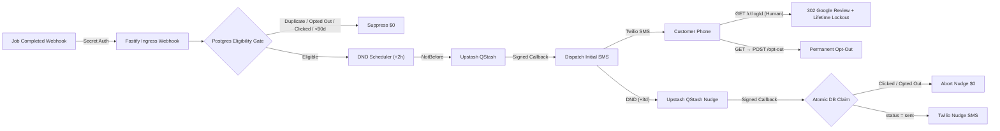

# Review Requester & Dispatch Engine
Event-driven, multi-tenant SMS review requester. Built to solve a common bottleneck for trade businesses: consistently capturing **Google Reviews** after completed jobs without spamming repeat customers, firing texts at midnight, or burning SMS credits on unengaged or opted-out contacts. Ingests job completion webhooks from **ServiceM8** (or any JMS), enforces idempotency, cooldown, and Do Not Disturb windows in PostgreSQL before dispatching timed review requests and conditional 3-day nudges via **Twilio**.

## End-to-End Request Flow

## Key Engineering & Hardening Decisions
* **Zero-Cost Eligibility Gate:** Parallelizes tenant lookup and `job_reference_id` idempotency checks (with PostgreSQL `23505` unique-constraint recovery for concurrent webhook bursts), then runs an O(1) latest-send lookup (`review_logs_customer_sent_idx`) to suppress opted-out numbers, lifetime-locked clickers, and contacts inside a 90-day cooldown before queuing any SMS.
* **DND-Aware Delayed Scheduling:** Schedules initial requests (+2 hours) and follow-up nudges (+3 days) via Upstash QStash `NotBefore` callbacks. Any dispatch falling inside the 20:00–08:00 local Do Not Disturb window is shifted automatically to 08:30 the next valid morning.
* **Atomic Nudge Locking:** Before sending a 3-day follow-up, workers execute a conditional atomic update (`WHERE status = 'sent' AND clicked_at IS NULL RETURNING id`). If a customer taps the review link milliseconds before QStash fires—or duplicate deliveries collide—the claim fails and the nudge aborts at zero SMS cost.
* **Bot-Safe Link Tracking & Two-Step Opt-Out:** Detects browser prefetch headers and automated preview crawlers (Applebot, WhatsApp, Facebook, Slack) on `GET /r/:logId`, returning a clean 302 redirect without mutating click metrics or triggering false lifetime lockouts. `GET /opt-out/:customerId` serves a confirmation page and only unsubscribes on `POST`, preventing link scanners from silently opting customers out.
* **Hardened Ingress, Callback Auth & PII Redaction:** Validates per-tenant webhook secrets with constant-time comparison (`timingSafeEqual`, supporting `x-webhook-secret`, `Bearer`, or `?secret=` for ServiceM8 webhooks), verifies `Upstash-Signature` headers on internal dispatch endpoints, issues unguessable Stripe-style prefixed IDs (`ten_`, `cus_`, `rev_`), and redacts auth headers and customer phone numbers in Pino logs while forwarding `x-trace-id` through QStash callbacks.
* **Spec-Driven Domain Verification & Local Sandbox:** Captures entity lifecycles, lockouts, and surface contracts formally in Allium v3 (`review-requester.allium`) verified by automated obligation and route security tests, backed by a swappable `DatabaseAdapter` (Neon PostgreSQL / in-memory) and an interactive `/dev` sandbox outbox for zero-cost local testing.

## Tech Stack
* **Runtime & API:** Node.js, TypeScript, Fastify v5 (hosted on Vercel)
* **Messaging & Scheduling:** Twilio SMS (alphanumeric sender IDs), Upstash QStash
* **Database & ORM:** Neon Serverless PostgreSQL, Drizzle ORM (with in-memory adapter for local/test runs)
* **Specification & Testing:** Allium v3, Node.js test runner (`node:test`), Pino structured logging

## Deep-Dive Documentation
* **[Requirements & API Contract](./requirements.md)** — Core business requirements, Drizzle PostgreSQL schema, and Fastify ingress, dispatch, and public shortlink route specifications.
* **[Formal Behavioral Specification](./review-requester.allium)** — Allium v3 domain model defining entity state transitions (`queued → sent → nudge_sent / clicked`), timing/cooldown config defaults, and boundary surfaces.

## Future Features
* **Google Business Profile API Integration:** To be able to determine when some has left a review, so an auto reply can be made. Also can determine which clients have not left reviews, using name to job matching.
